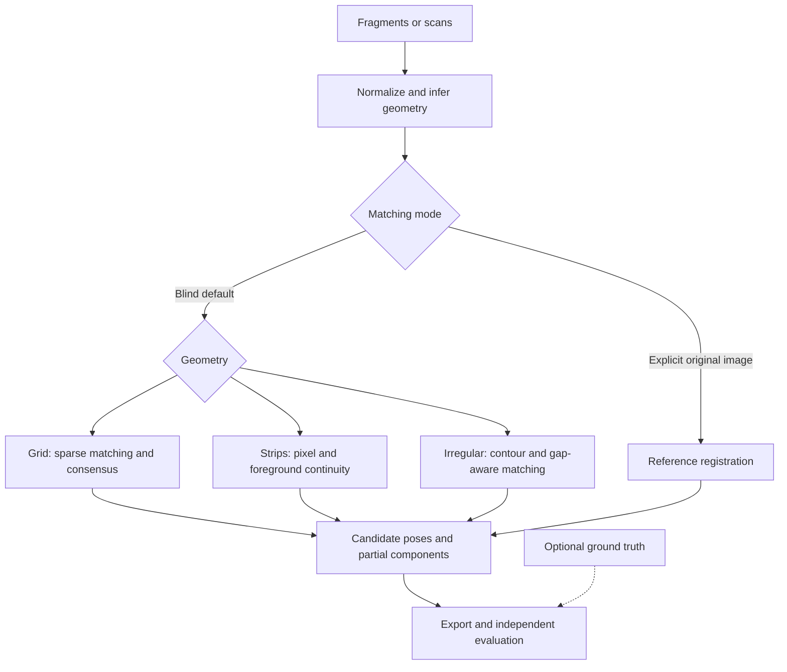

<div align="center">

# Shardelix

**Reference-free image and document fragment reconstruction**

A CPU-first computer vision framework for shuffled, rotated, irregular,
and incomplete fragments. Blind reconstruction uses observed geometry and
pixels — no original image, OCR, trained model, or GPU required.

[](pyproject.toml)
[](LICENSE)
[](pyproject.toml)
[](cpp/)
[](docs/WEB.md)
[](#architecture)
[](https://github.com/Daydreamer2812/Shardelix/actions/workflows/ci.yml)
[](https://github.com/Daydreamer2812/Shardelix/actions/workflows/web-smoke.yml)

[Web Studio](https://daydreamer2812.github.io/Shardelix/) ·
[Releases](https://github.com/Daydreamer2812/Shardelix/releases) ·
[Quick start](#quick-start) · [Benchmarks](#benchmarks) ·
[Documentation](docs/README.md)

<!-- SHOWCASE_START -->


*Actual historical V13 output: 36 rotated jigsaw fragments, seed 42; DPA = 100%, adjacency F1 = 100%, collision pixels = 0. Reference photograph: NASA via scikit-image. [Measured results](reports/v13/photo-showcase.json) · [Reproduce](scripts/make_photo_showcase.py).*
<!-- SHOWCASE_END -->

</div>

## Overview

Shardelix reconstructs shuffled, rotated, irregular and partially missing
image fragments using classical computer vision. Geometry, observed pixels
and masks drive the solution; a trained model, OCR, GPU or original image
is not required for blind reconstruction.

- **Digital puzzles:** regular grids, strips, wavy, jagged, jigsaw and custom masks.
- **Physical documents:** scanned strips, unequal widths, scan alignment and
  experimental contour recovery when edges are damaged.
- **Partial reconstruction:** uncertain seams and disconnected components
  remain explicit; missing pixels are not fabricated.
- **Shared engine:** Python API, CLI and local/browser Studio; optional
  C++20 acceleration and WebAssembly.

**Evaluation is separate from inference.** Ground truth is used only after
blind reconstruction. An intact matching image is accepted only in the
explicit reference-assisted mode.

## Quick start

### Browser

[Open Web Studio](https://daydreamer2812.github.io/Shardelix/). Generate a
puzzle or import a fragment ZIP, then select Automatic detection and
Balanced. Images are processed locally by the browser worker.

### Install from source

Python 3.11+ is required. A C++20 compiler is optional.

```bash
git clone https://github.com/Daydreamer2812/Shardelix.git
cd Shardelix
python -m venv .venv
# Linux/macOS: source .venv/bin/activate
# Windows PowerShell: .venv\Scripts\Activate.ps1
python -m pip install -e .
python -m shardelix doctor
python -m shardelix studio
```

For native acceleration, run `python scripts/build_native.py`.
The portable Python implementation works without it. V15.0.1 is a
[maintenance release](docs/releases/v15.0.1.md), with safer exports and
installation checks; the V15 research results below are unchanged. See
[installation and API](docs/FRAMEWORK_API.md) for wheel builds, optional
dependencies and resource limits. PyPI publication is not configured.

### CLI

```bash
# Reference-free reconstruction
shardelix reconstruct fragments.zip --out outputs/blind
# Evaluate predicted assembly independently
shardelix reconstruct fragments.zip --ground-truth truth.zip --out outputs/evaluated
# Explicit reference-assisted reconstruction (separate protocol)
shardelix reconstruct fragments.zip --reference original.jpg --out outputs/assisted
# Generate and solve a reproducible digital case
shardelix run data/examples/straight_texture.png --cut grid --pieces 256 --rotations --profile balanced --seed 42 --out outputs/grid
```

### Python

```python
from shardelix import reconstruct_files

result = reconstruct_files("fragments.zip", "outputs/blind", profile="balanced")
```

For in-memory fragment arrays, public geometry constraints and custom
resource budgets, see [examples/framework.py](examples/framework.py) and
the [API reference](docs/FRAMEWORK_API.md).

## Benchmarks

V15.0.0 paired results, with the same evaluation protocol for both
versions. These selected samples are not a general accuracy guarantee.

| Evaluation | V14.5 | V15.0 |
|:--|--:|--:|
| DocDataset real scans, 3 development pages (directed adjacency) | 119/119 | 119/119 |
| Mechanical strips, 37 selected pages (global reversal allowed) | 599/853 | **606/853** |
| Newly held-out mechanical pages (7 of the 37 above) | 129/165 | 129/165 |
| Simulated scan damage, 8 cases (adjacency) | 73/248 | 73/248 |
| Simulated scan damage (vertical MAE) | 2.20 px | **0.36 px** |
| Continuous erosion, 4 cases (correct/accepted relative joins) | 7/10 | **8/9** |

Distinctive seams: 175/184 correct (95.1% observed precision, 21.6%
coverage of possible mechanical joins). This is not full-page accuracy.
Severe erosion remains difficult; the blind DAFNE development case yields
4/39 correct accepted relative joins, not a successful reconstruction.

Historical intact synthetic scaling reached 100,000 irregular fragments
under a different, easier protocol. Reference-assisted results must not
be compared directly with blind reconstruction.

[Technical report](docs/TECHNICAL_REPORT.md) ·
[Raw V15 evidence](reports/v15/) · [All results](reports/README.md) ·
[Data and protocols](docs/DATASETS.md)

To reproduce measurements, place external data under `data/external/`
and configure the [example manifest](benchmarks/manifest.example.json):

```bash
python benchmarks/benchmark_suite.py --manifest benchmarks/manifest.example.json --out outputs/benchmark
```

[Benchmark runner index](benchmarks/README.md) · [Resource scaling](docs/RESOURCE_SCALING.md)

## Architecture



The Python layer manages geometry, matching, verification and assembly.
Optional C++20 kernels accelerate intensive operations; browser builds
share the same engine. Fast, Balanced and Accurate change search effort,
not the public interface.

[Detailed architecture](docs/ARCHITECTURE.md) · [Resource policy](docs/RESOURCE_SCALING.md)

## Repository layout

```text
Shardelix/
├── src/shardelix/            # Installable Python framework
│   └── reconstruction/
│       ├── tiles/             # Grid and sparse tile matching
│       ├── strips/            # Digital and physical document strips
│       ├── irregular/         # Contours and damaged-edge recovery
│       └── reference/         # Explicit reference-assisted registration
├── cpp/                       # Native C++20 kernels
├── web/                       # Browser worker and WASM bridge
├── benchmarks/                # Independent evaluation and stress runners
├── reports/                   # Preserved numerical evidence
├── tests/
│   ├── algorithms/            # Solver and geometry regressions
│   └── integration/           # Web packaging and evaluator checks
├── scripts/                   # Build, QA and fixture tools
├── examples/                  # Public API example
├── data/examples/             # Synthetic input fixtures
├── docs/                      # Guides, research methods and release notes
└── .github/                   # CI, releases and Pages deployment
```

Generated results belong in `outputs/`; external datasets are not
distributed with the source. Historical reports retain their original paths.

## Development

```bash
python -m pip install -e ".[dev]"
python scripts/build_native.py
python -m unittest discover -s tests -t .
python scripts/smoke_studio.py
```

See [contributing](CONTRIBUTING.md), [development tools](scripts/README.md),
[documentation index](docs/README.md), and
[release history](docs/releases/README.md).

## Limitations

Shardelix is alpha research software. Repetitive or blank texture, severe
missing boundaries, clutter, unknown orientation and perspective may
prevent correct reconstruction. Protective resource limits are not
capacity or accuracy guarantees. See the
[technical report](docs/TECHNICAL_REPORT.md) for evidence, acceptance
criteria and unresolved research questions.

## Citation and license

Maintained by [Daydreamer2812](https://github.com/Daydreamer2812).
Cite the exact release or commit using [CITATION.cff](CITATION.cff).

Source code and original documentation are licensed under the
[MIT License](LICENSE), copyright (c) 2026 Daydreamer2812. Third-party
assets, datasets and dependencies retain their respective terms;
see [data provenance](data/README.md).

[Contributing](CONTRIBUTING.md) · [Security](SECURITY.md) ·
[Report an issue](https://github.com/Daydreamer2812/Shardelix/issues/new/choose)
