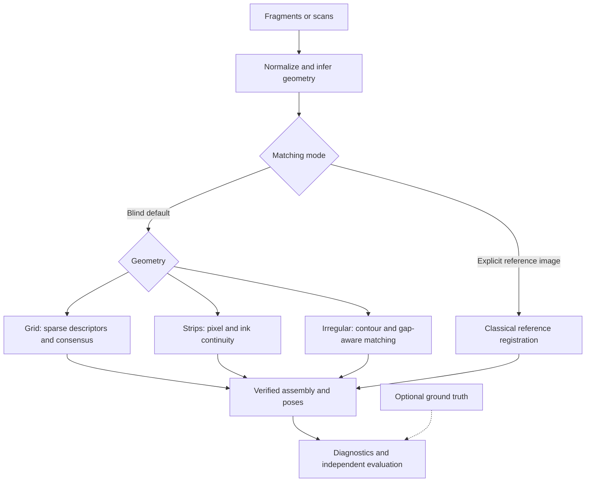

<div align="center">

# Shardelix

**Reference-free image and document fragment reconstruction**

A CPU-first computer vision framework for shuffled, rotated, irregular,
and incomplete fragments. Blind reconstruction uses observed geometry and
pixels — no original image, OCR, trained model, or GPU required.

[](pyproject.toml)
[](LICENSE)
[](pyproject.toml)
[](cpp/)
[](docs/WEB.md)
[](#architecture)
[](https://github.com/Daydreamer2812/Shardelix/actions/workflows/ci.yml)
[](https://github.com/Daydreamer2812/Shardelix/actions/workflows/web-smoke.yml)
[](https://github.com/Daydreamer2812/Shardelix/stargazers)
[](https://github.com/Daydreamer2812/Shardelix/releases)

[Web Studio](https://daydreamer2812.github.io/Shardelix/) ·
[Releases](https://github.com/Daydreamer2812/Shardelix/releases) ·
[Quick start](#quick-start) · [Benchmarks](#benchmarks) ·
[Documentation](docs/README.md)

<!-- SHOWCASE_START -->


*Actual historical V13 output: 36 rotated jigsaw fragments, seed 42; DPA = 100%, adjacency F1 = 100%, collision pixels = 0. Reference photograph: NASA via scikit-image. [Measured results](reports/v13/photo-showcase.json) · [Reproduce](scripts/make_photo_showcase.py).*
<!-- SHOWCASE_END -->

</div>

---

## Overview

Shardelix combines classical vision, complementary contour matching,
pixel continuity, pose verification, and constrained global assembly.
It supports generation of reproducible puzzles as well as importing real
fragment images and scanned documents.

| Capability | Status |
|:--|:--|
| Grid, strips, jagged, wavy, jigsaw, and custom masks | Supported |
| Quarter-turn rotations and missing digital fragments | Supported |
| Arbitrary in-plane rotations and eroded edges | Experimental |
| Physical document strips with unequal widths and damaged margins | Experimental |
| Blind and explicitly reference-assisted reconstruction | Separate protocols |
| Browser Studio, CLI, and Python API | Supported |

**Blind by default.** The blind engine receives observed pixels and masks,
optionally with public geometry constraints (canvas, cut family, grid).
Ground truth is reserved for independent post-reconstruction evaluation.
Only the explicit reference-assisted mode can use an intact source image.
Missing material remains transparent; disconnected components are not
forced into an invented global layout.

## Quick start

### Web Studio

[Open Shardelix Studio](https://daydreamer2812.github.io/Shardelix/).
Generate a puzzle and transfer it directly to Reconstruction, or import
an image-fragment ZIP. Choose **Automatic detection** and **Balanced**.
The worker processes inputs locally in the browser.

### Native installation

Requires Python 3.11+; a C++20 compiler is optional for native acceleration.

```bash
git clone https://github.com/Daydreamer2812/Shardelix.git
cd Shardelix
python -m venv .venv
# Linux/macOS: source .venv/bin/activate
# Windows PowerShell: .venv\Scripts\Activate.ps1
python -m pip install -e .
python scripts/build_native.py
python -m shardelix studio
```

Install a portable Python wheel without a compiler, or explicitly compile
a platform wheel:

```bash
python -m pip wheel --no-deps .
# Linux/macOS (C++20 compiler required):
SHARDELIX_BUILD_NATIVE=1 python -m pip wheel --no-deps .
```

On Windows set `$env:SHARDELIX_BUILD_NATIVE = "1"` in PowerShell and
provide a MinGW C++20 compiler. Platform wheel CI covers Linux, macOS
and Windows; PyPI distribution is not yet configured.

The engine also runs with the Python fallback
(`SHARDELIX_CORE=python`). Install `.[reference]` for optional OpenCV/SIFT
reference registration or `.[pdf]` for native PDF generation.

### Command line

```bash
# Reconstruct anonymous fragments
python -m shardelix reconstruct fragments.zip --out outputs/blind
# Evaluate independently after reconstruction
python -m shardelix reconstruct fragments.zip --ground-truth truth.zip --out outputs/evaluated
# Explicit reference-assisted protocol
python -m shardelix reconstruct fragments.zip --reference original.jpg --out outputs/assisted
# Generate and solve a reproducible synthetic example
python -m shardelix run data/examples/straight_texture.png --cut grid --pieces 256 --rotations --profile balanced --seed 42 --out outputs/grid
```

### Python API

```python
from shardelix import reconstruct_files, Solver

result = reconstruct_files("fragments.zip", "outputs/blind", profile="balanced")

solver = Solver(profile="balanced")
prediction = solver.solve(
    "case/pieces",
    shape=(1024, 1024), cut="grid", grid=(32, 32), rotations=True,
)
prediction.save("outputs/grid")
print(prediction.summary())
```

[Complete CLI/API reference](docs/FRAMEWORK_API.md) ·
[Self-host the Studio](docs/WEB.md) · [Example code](examples/framework.py)

## Benchmarks

Measured accuracy is reported separately for each protocol. These are
recorded experiments, not a guarantee of general-purpose reconstruction.

### Physical document reconstruction — V15.0

| Dataset / evaluation | V14.5 | V15.0 |
|:--|--:|--:|
| DocDataset Real, three development pages (directed joins) | 119/119 | 119/119 |
| Mechanical scans: 30 previously observed pages | 470/688 | **477/688** |
| Mechanical scans: 7 newly held-out pages | 129/165 | 129/165 |
| **Mechanical scans: 37 selected pages** | 599/853 (70.2%) | **606/853 (71.0%)** |
| Simulated scan damage: adjacency, 8 cases | 73/248 | 73/248 |
| Simulated scan damage: vertical registration MAE | 2.20 px | **0.36 px** |
| Continuous-rotation erosion: correct/accepted relative joins, 4 cases | 7/10 | **8/9** |

The new seam evidence identifies 175 correct of 184 distinctive joins on
the mechanical sample (21.6% coverage, 95.1% observed precision).
The scores are diagnostic, not calibrated probabilities. The complete
chain remains provisional where seams lack evidence; independent strip
components can now be exported. Hard damaged or ambiguous cases remain
experimental, especially when many pieces are missing or unrelated.

[Release notes](docs/releases/v15.0.0.md) ·
[Technical report and acceptance checklist](docs/TECHNICAL_REPORT.md) ·
[Per-case comparisons](reports/v15/) · [Data and evaluation protocols](docs/DATASETS.md)

### Physical document reconstruction — historical V14.5

| Dataset / evaluation | V14.4 | V14.5 |
|:--|--:|--:|
| DocDataset Real, three development pages (directed joins) | 119/119 | **119/119** |
| Mechanical scan sample, 21 development pages | 321/491 | **375/491** |
| Six additional S-CDIP pages (final policy) | 53/129 | **68/129** |
| Three final held-out S-CDIP pages | 28/68 | 27/68 |
| **Mechanical scans, 30 selected pages** | **402/688 (58.4%)** | **470/688 (68.3%)** |
| Simulated scan damage, eight historical cases | 73/248 | 73/248 |

DocDataset also retains 122/122 exact positions. Mechanical-scan scores
allow one global chain reversal and count rejected pages as zero; they
do not verify individual orientations or raster alignment. The selected
sample is not representative of all real documents.

- V14.5 adds phase-aware, band-phase, and ink-weighted patch residuals
  without extra nearest-neighbor searches; calibrated cut-gap winners
  are protected.
- V14.4's speed-only change measured **1.69×** faster on the three real
  DocDataset scans (89.42 s → 53.05 s); no controlled V14.5 speedup is claimed.

[Historical release](docs/releases/v14.5.0.md) ·
[Per-page results](reports/v14/scan_document_v145.json) ·
[Data and protocol](docs/DATASETS.md)

### Native scaling — historical intact synthetic irregular fragments

| Fragments | Exact primary poses | Correct accepted joins | Solver time | Peak RSS |
|--:|--:|--:|--:|--:|
| 8,192 | 8,192/8,192 | 8,191/8,191 | 11.82 s | 446 MiB |
| 16,384 | 16,384/16,384 | 16,383/16,383 | 25.25 s | 827 MiB |
| 32,768 | 32,768/32,768 | 32,767/32,767 | 55.40 s | 1,569 MiB |
| 65,536 | 65,536/65,536 | 65,535/65,535 | 113.63 s | 2,384 MiB |
| 100,000 | 100,000/100,000 | 99,999/99,999 | 177.32 s | 2,664 MiB |

Historical native engine integrated into V14; quarter-turns, seed 827,
intact complementary pixel-lattice edges. Solver time excludes generation,
ZIP I/O, rendering, and evaluation. The 131,072-piece probe abstained at
a working-memory preflight guard, not a fixed algorithm limit.
V14's separate 4,096-piece paired C++ index experiment measured **1.50×**
speedup (5.585 → 3.722 s median), with identical correct poses and joins.

[Scaling protocol](docs/RESOURCE_SCALING.md) ·
[Raw scaling results](reports/resource_scaling.json) ·
[Paired C++ measurements](reports/v14/paired_arc.json)

### Difficult inputs and reference-assisted results

| Protocol | Recorded result | Evidence |
|:--|:--|:--|
| Blind DAFNE Resurrection | 6/13 correct accepted joins; 3/87 primary poses | [Eroded recovery](docs/ERODED_RECOVERY.md) |
| Blind DAFNE Masaccio | 0/11 correct accepted joins; 1/101 gauge anchor | [Eroded recovery](docs/ERODED_RECOVERY.md) |
| Blind synthetic erosion, 11 V14.2 development cases | 39/39 correct accepted joins (from 30/61); partial components, not full images | [V14.2](docs/releases/v14.2.0.md) |
| Reference-assisted DAFNE, 28 configurations | 6,027/6,029 poses; 1,154/1,154 distractors rejected | [DAFNE indexed protocol](docs/DAFNE_INDEXED.md) |

Blind real torn-paper reconstruction remains unsolved. Reference-assisted
DAFNE uses the original artwork at 10 px / 10° tolerance and is not a blind
benchmark. Do not compare these numbers as if they used the same protocol.

[All benchmarks and raw reports](reports/README.md) ·
[V14 results](docs/V14_RESULTS.md) · [Release history](docs/releases/README.md)

## Architecture



Python / NumPy / SciPy orchestrate the geometry-specific algorithms.
C++20 accelerates contour tracing, packed chain-code votes, exact lattice
contact, edge descriptors, and seam re-ranking. The same accelerator is
available through WebAssembly. This is a hybrid framework, not a C++-only
solver.

| Profile | Search effort |
|:--|:--|
| Fast | Reduced search; bounded rescue for severe under-coverage |
| Balanced | Recommended adaptive search and verification |
| High accuracy | Additional hypotheses and deeper bounded recovery |

[Architecture and module map](docs/ARCHITECTURE.md) ·
[Framework](docs/FRAMEWORK.md) · [Resource policy](docs/RESOURCE_SCALING.md)

## Resource limits and limitations

| Protective guard | Native | Browser |
|:--|--:|--:|
| Uniform grid | 262,144 | 4,096 |
| Known-canvas strips / irregular | 8,192 / 4,096 | ≤4,096 |
| Metadata-free irregular/scan | Adaptive, outer cap 262,144 | 4,096 |
| Physical document strips | 128 | 128 |
| Decoded input pixels | Up to 330 MP | 24 MP |
| Canvas (digital / adaptive scan) | 110 MP / up to 330 MP | 8 MP |
| Scan solver memory estimate | Up to 55% available RAM | 256 MiB |

These are protective preflight limits, not demonstrated accuracy or capacity.
Actual limits depend on available RAM, raster dimensions and candidate density.
Repeated or blank edges, arbitrary perspective, severe erosion, and unknown
orientation may remain ambiguous. Native measurements do not establish
WebAssembly performance. This is alpha research software.

[Full limits and scaling](docs/RESOURCE_SCALING.md) · [Browser limits](docs/WEB.md)

## Repository layout

```text
src/shardelix/             Python API, CLI, workflow and reconstruction
  reconstruction/
    tiles/                 Grid and sparse tile matching
    strips/                Document and strip continuity
    irregular/             Contours and damaged-edge recovery
    reference/             Explicit assisted registration
cpp/                       Portable C++20 kernels
web/                       Browser worker and accelerator bridge
scripts/                   Build, benchmark and evaluation tools
tests/                     Algorithm and workflow regression tests
docs/                      Architecture, methods, protocols, release notes
reports/                   Versioned numerical evidence
data/examples/             Generated example fixtures
examples/                  Public API example
```

[Documentation index](docs/README.md) · [Script index](scripts/README.md) ·
[Benchmark index](reports/README.md) · [Contributing](CONTRIBUTING.md)

## Development

```bash
python -m pip install -e '.[dev]'
python scripts/build_native.py
python -m unittest discover -s tests/v2
python -m unittest discover -s tests/workflow
python scripts/smoke_studio.py
```

See the [V15 release verification](docs/releases/v15.0.0.md) for regression,
wheel installation and benchmark scope.

## Citation and contributing

Maintained by [Daydreamer2812](https://github.com/Daydreamer2812).
For research, cite the exact release or commit using [CITATION.cff](CITATION.cff).

[Contributing](CONTRIBUTING.md) · [Security](SECURITY.md) ·
[Report an issue](https://github.com/Daydreamer2812/Shardelix/issues/new/choose)

## License

Shardelix source code and original documentation are released under the
[MIT License](LICENSE). Copyright (c) 2026 Daydreamer2812.
External datasets, dependencies, and third-party assets have separate rights
and must be obtained under their applicable terms. See [data provenance](data/README.md).
