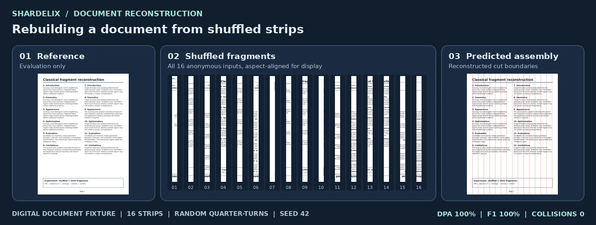
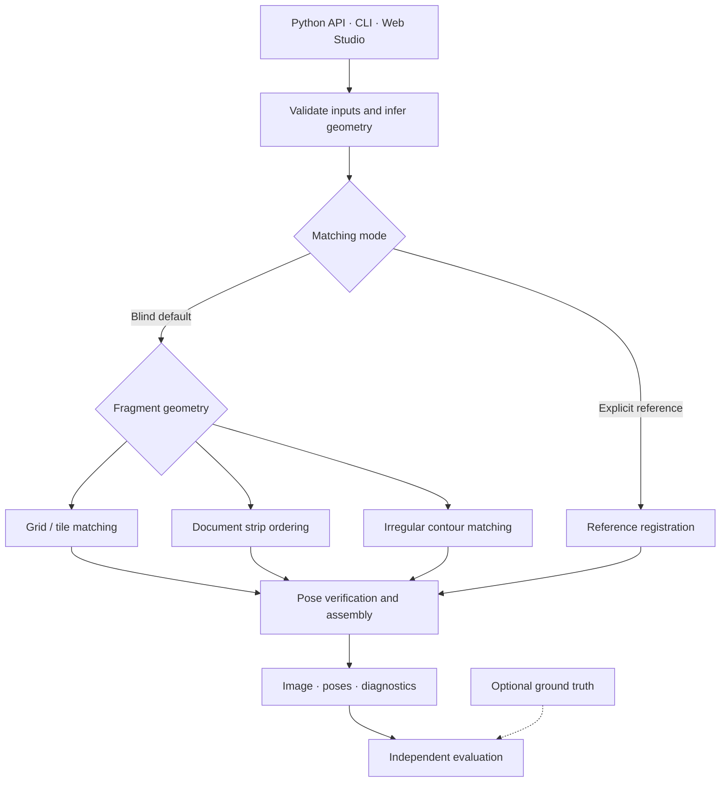

<div align="center">


# Shardelix

**Classical computer vision for image and document fragment reconstruction**

Reassemble shuffled, rotated, irregular and partially missing fragments from
their observed geometry and pixels. No training, OCR or GPU required.

[](docs/releases/v15.0.1.md)
[](LICENSE)
[](pyproject.toml)
[](cpp/)
[](docs/WEB.md)

[](https://github.com/Daydreamer2812/Shardelix/actions/workflows/ci.yml)
[](https://github.com/Daydreamer2812/Shardelix/actions/workflows/wheels.yml)
[](https://github.com/Daydreamer2812/Shardelix/actions/workflows/web-smoke.yml)

**[Open Web Studio](https://daydreamer2812.github.io/Shardelix/)** ·
[Quick start](#quick-start) · [Benchmarks](#benchmarks) ·
[Documentation](docs/README.md) · [Releases](https://github.com/Daydreamer2812/Shardelix/releases)

<!-- SHOWCASE_START -->


*Actual historical V13 output · 36 rotated jigsaw fragments · DPA 100% · adjacency F1 100% · zero collision pixels. Reference photograph: NASA via scikit-image. [Measured results](reports/v13/photo-showcase.json) · [Reproduce](scripts/make_photo_showcase.py).*
<!-- SHOWCASE_END -->

</div>

## Overview

Shardelix is an open-source **research framework** for reconstructing
fragmented images and documents on ordinary CPUs. It combines geometric
descriptors, pixel continuity, sparse matching, global consistency and
collision-aware assembly in one engine.

| Problem | Supported reconstruction |
| :--- | :--- |
| **Digital images** | Regular grids, strips, jagged, wavy, jigsaw and custom masks |
| **Document scans** | Unknown strip order, unequal widths, orientation and row alignment |
| **Irregular fragments** | Contour matching, arbitrary-angle pose estimation and experimental damaged-edge recovery |
| **Incomplete inputs** | Missing pieces, tentative seams, unplaced fragments and disconnected components |

Blind reconstruction is the default: the solver receives fragments, not the
original image. An intact reference image can be supplied **explicitly** for
assisted registration; results from this separate protocol are never pooled
with blind benchmarks. Ground truth is reserved for independent evaluation.

### Document reconstruction



*Actual V15.0.1 output on the repository's [digital document fixture](data/examples/text_document.png):
16 shuffled strips with random quarter-turns, seed 42. DPA 100%, adjacency
F1 100% and zero collision pixels. Input strips are aspect-aligned for display
only. This is a digital demonstration, not a physical-scan accuracy claim.*

## Quick start

### 1. Try in your browser

Open **[Shardelix Web Studio](https://daydreamer2812.github.io/Shardelix/)**.
Generate a fragment set or import images/ZIP, choose automatic detection and
the Balanced profile, then inspect the predicted assembly and its seams.
Images are processed locally by the browser worker.

### 2. Install the framework

Requires Python 3.11 or later. Native C++20 acceleration is optional.

```bash
git clone https://github.com/Daydreamer2812/Shardelix.git
cd Shardelix
python -m venv .venv
# Linux/macOS: source .venv/bin/activate
# Windows PowerShell: .venv\Scripts\Activate.ps1
python -m pip install -e .
shardelix doctor
```

To launch the local Studio or build the optional native accelerator:

```bash
shardelix studio
python scripts/build_native.py
shardelix doctor --require-native
```

The portable Python backend works without a compiler. See the
[installation guide](docs/FRAMEWORK_API.md) for wheel builds, optional PDF
and OpenCV support, and platform requirements. PyPI publishing is not
currently configured.

### 3. Reconstruct with the CLI

```bash
# Blind reconstruction from fragment files or an archive
shardelix reconstruct fragments.zip --out outputs/blind

# Reproduce the document demonstration above
shardelix run data/examples/text_document.png --max-side 1024 --cut strips --pieces 16 --rotations --profile balanced --seed 42 --out outputs/document --require-95
```

Use `--ground-truth truth.zip` for evaluation only, or
`--reference original.jpg` to select the separate assisted-matching mode.

### 4. Integrate with Python

```python
from shardelix import reconstruct_files

state = reconstruct_files(
    "fragments.zip",
    "outputs/blind",
    profile="balanced",
)
print(state["diagnostics"])
```

Choose a new or empty output directory. The engine exports the assembled
image, predicted cut overlay, placements and diagnostics, with uncertainty
and unplaced fragments reported where supported. The lower-level
`Solver` API accepts RGBA fragments and explicit geometric constraints.

[Public API](docs/FRAMEWORK_API.md) · [Integration example](examples/framework.py) ·
[Web guide](docs/WEB.md)

## Benchmarks

Results use distinct protocols. **DPA** is direct position accuracy;
**adjacency** measures correct neighboring fragments. These measurements
describe the evaluated cases, not a general reconstruction guarantee.

### V15 blind reconstruction evidence

| Dataset / metric | V14.5 | V15.0 |
| :--- | ---: | ---: |
| DocDataset real scans, 3 development pages — directed joins | 119/119 | 119/119 |
| Mechanical strips, 37 selected pages — correct joins, global reversal allowed | 599/853 | **606/853** |
| Mechanical strips, 7 new holdout pages (subset of the above) | 129/165 | 129/165 |
| Simulated scan damage, 8 cases — correct undirected joins | 73/248 | 73/248 |
| Simulated scan damage — vertical offset MAE | 2.20 px | **0.36 px** |
| Continuous erosion, 4 cases — correct / accepted relative joins | 7/10 | **8/9** |

V15's distinctive-seam diagnostic identified **175/184 correct joins**
(95.1% observed precision, 21.6% coverage of possible mechanical joins).
That is local seam precision, not whole-page accuracy. Severe erosion
and outlier rejection remain difficult: the blind DAFNE development case
achieved only 4/39 correct accepted relative joins.

### V15.0.1 framework validation

| Check | Local result (Linux, Python 3.12) |
| :--- | :--- |
| Native C++ backend | 165 tests passed |
| Python fallback | 159 passed, 6 native-only tests skipped |
| Combined line/branch coverage | 74% (CI floor 72%) |
| Distribution | Portable wheel, Linux native wheel and source archive validated |
| Synthetic torn-edge stress, 512 intact-boundary fragments | 512/512 exact global poses · 0.342 s solver · 80.7 MiB process peak RSS |

Historical in-memory stress experiments reached 100,000 synthetic intact
irregular fragments under an easier exact-contact protocol. Neither that
result nor the 512-piece smoke test establishes performance on damaged
physical documents. Cross-platform CI is tracked separately above.

[Technical report](docs/TECHNICAL_REPORT.md) ·
[Raw V15 results](reports/v15/) · [V15.0.1 validation](docs/releases/v15.0.1.md) ·
[Data and protocols](docs/DATASETS.md) · [Resource scaling](docs/RESOURCE_SCALING.md)

<details>
<summary><strong>Reproduce the research benchmarks</strong></summary>

Place the external datasets under `data/external/` and configure the
[example manifest](benchmarks/manifest.example.json) with their local paths.

```bash
python benchmarks/benchmark_suite.py --manifest benchmarks/manifest.example.json --out outputs/benchmark
```

[Benchmark runner index](benchmarks/README.md) · [Historical reports](reports/README.md)

</details>

## Architecture



Python orchestrates matching and assembly; C++20 kernels accelerate
computational hot spots, and WebAssembly supports browser execution.
Fast, Balanced and Accurate profiles adjust search effort through the
same public interface.

[Architecture guide](docs/ARCHITECTURE.md) ·
[Coordinate conventions](docs/COORDINATE_CONVENTIONS.md) · [Resource policy](docs/RESOURCE_SCALING.md)

## Project structure

| Directory | Purpose |
| :--- | :--- |
| [`src/shardelix/`](src/shardelix/) | Installable core, public API and shared workflow |
| [`cpp/`](cpp/) · [`web/`](web/) | Native accelerator, WebAssembly bridge and worker |
| [`benchmarks/`](benchmarks/) · [`reports/`](reports/) | Evaluation runners and preserved evidence |
| [`tests/`](tests/) | Algorithm regressions and integration tests |
| [`scripts/`](scripts/) · [`examples/`](examples/) | Build, QA, fixtures and API examples |
| [`data/`](data/) · [`docs/`](docs/) | Example inputs, data provenance and technical guides |

Keep generated artifacts in `outputs/` and external datasets in
`data/external/`; neither belongs in source control.

## Documentation

| Start here | Research and development |
| :--- | :--- |
| [Framework API and CLI](docs/FRAMEWORK_API.md) | [Technical report](docs/TECHNICAL_REPORT.md) |
| [Web Studio](docs/WEB.md) | [Eroded-boundary recovery](docs/ERODED_RECOVERY.md) |
| [Architecture](docs/ARCHITECTURE.md) | [Datasets and protocols](docs/DATASETS.md) |
| [Release history](docs/releases/README.md) | [Contributing](CONTRIBUTING.md) |

See the complete [documentation index](docs/README.md) for advanced topics.

## Development and limitations

```bash
python -m pip install -e ".[dev]"
python scripts/build_native.py
python -m unittest discover -s tests -t .
python scripts/smoke_studio.py
```

Shardelix is **alpha research software**. Blank/repetitive textures, severe
boundary loss, clutter, unknown orientation and perspective distortion may
prevent a correct reconstruction. Partial or ambiguous results are not
verified accuracy; missing material is never fabricated. Resource guards
are not capacity or latency guarantees. No SOTA claim is made without a
controlled comparison on independent test data.

## Citation and license

If you use Shardelix in research, cite the exact release or commit using
[CITATION.cff](CITATION.cff).

Licensed under the [MIT License](LICENSE), copyright (c) 2026
[Daydreamer2812](https://github.com/Daydreamer2812). Third-party assets,
datasets and dependencies retain their respective terms; see
[data provenance](data/README.md).

<div align="center">

[Contribute](CONTRIBUTING.md) · [Report an issue](https://github.com/Daydreamer2812/Shardelix/issues/new/choose) ·
[Security](SECURITY.md)

</div>
