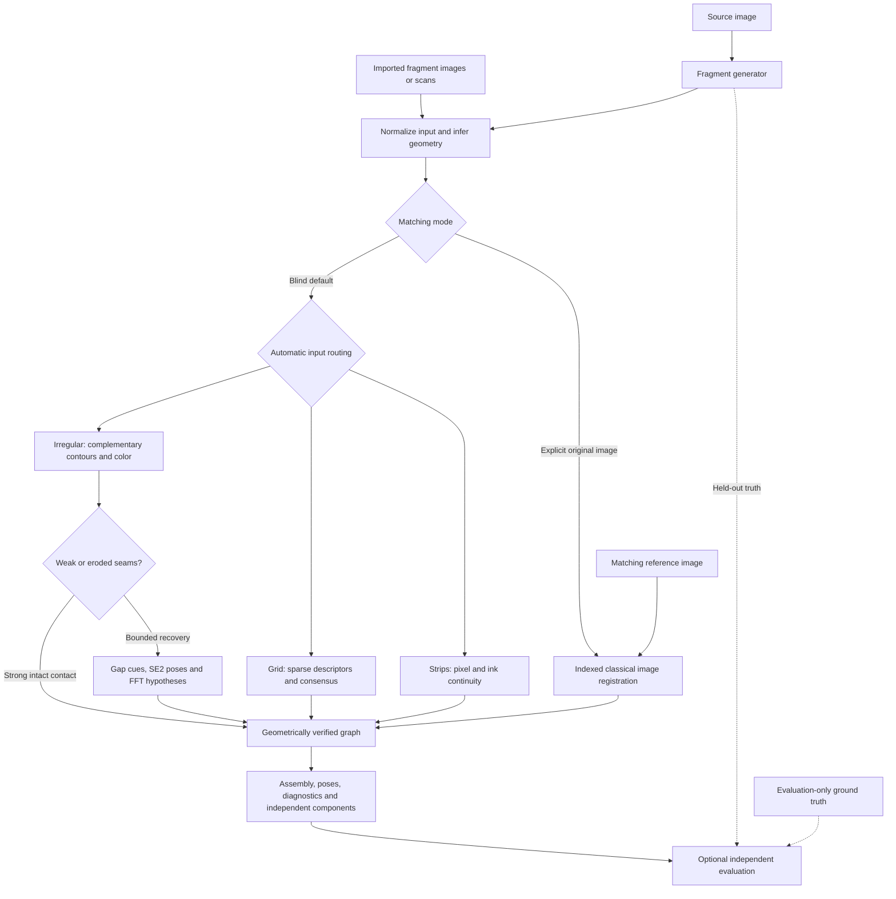

<div align="center">

# Shardelix

### Reference-free blind image & document reconstruction

**Reconstruct the unseen. Recover structure from fragments alone.**

A CPU-first, training-free classical computer vision framework for shuffled,
rotated, irregular and incomplete fragments. No original image, ground-truth
poses, OCR, trained model or GPU is required for blind reconstruction.

[](pyproject.toml)
[](pyproject.toml)
[](cpp/)
[](docs/WEB.md)
[](#architecture)
[](https://github.com/Daydreamer2812/Shardelix/actions/workflows/ci.yml)
[](https://github.com/Daydreamer2812/Shardelix/actions/workflows/web-smoke.yml)
[](https://github.com/Daydreamer2812/Shardelix/stargazers)
[](https://github.com/Daydreamer2812/Shardelix/releases)

[**Launch Web Studio**](https://daydreamer2812.github.io/Shardelix/) ·
[**Releases**](https://github.com/Daydreamer2812/Shardelix/releases) ·
[**Quick start**](#quick-start) · [**V14 benchmarks**](#benchmarks) ·
[**Python API**](#python-api)

<!-- SHOWCASE_START -->


*Actual historical V13 output: 36 rotated jigsaw fragments, seed 42; DPA = 100%, adjacency F1 = 100%, collision pixels = 0. Reference photograph: NASA via scikit-image. [Measured results](reports/v13/photo-showcase.json) · [Reproduce](scripts/make_photo_showcase.py).*
<!-- SHOWCASE_END -->

</div>

---

## What's new in V14

**14.5.0 damaged physical-document update:** robust same-page patch
residuals tolerate small vertical misregistration, piecewise scan drift and
ambiguous blank patches, without additional nearest-neighbor searches.
A dominant-width guard admits locally expanded long strips without relaxing
the interior-hole check. Calibrated cut-gap winners remain protected.
[Real-scan benchmarks and limitations](docs/releases/v14.5.0.md).

**14.4.0 physical-scan performance and coverage update:** bounded parallel
same-page patch queries and assignment-based subtour branching replace the
MILP path refinement. High-resolution scans with unequal strip widths retain
stroke aspect ratio in matching; regular equal-width cuts keep horizontal
detail. Very long tapered strips with contiguous masks are accepted more
often. An independent mechanical-strip benchmark covers S-MARQUES,
S-ISRI-OCR and S-CDIP, including damaged edges and heterogeneous content.
The accuracy and time claims are limited to the measured samples.
[Measurements and limitations](docs/releases/v14.4.0.md).

**14.3.0 real-document update:** all **119/119 directed joins and 122/122 exact
strip positions** are correct on the three real DocDataset development scans,
compared with 109/119 joins and 92/122 positions in V14.2. Two independent
filename-anonymization seeds reproduce the result. Dense pixel-only patch
continuation tests two explicit cut-loss gaps; reciprocal edge evidence selects
one chain before global refinement. No OCR, reference page or language model.
This is an in-development dataset result, not a general accuracy guarantee.
[Real-scan evidence](docs/releases/v14.3.0.md).

**14.2.0 damaged-fragment update:** multi-radius offset-contour proposals
and independent observed-mask/texture bridge checks recover curved eroded
seams without forcing missing material into contact. On 11 paired synthetic
development cases, accepted relative joins improve from 30/61 to 39/39;
four additional continuous-rotation cases improve from 0/25 to 7/10.
These are partial component results, not full-image accuracy.
[Damage-recovery evidence](docs/releases/v14.2.0.md).

**14.1.0 scan update:** blind scanned-document strip adjacency improves from
90/119 (75.6%) to 109/119 (91.6%) on the three DocDataset development scans.
The 56-strip page is fully recovered. Local shadow removal, text-row registration
and bounded global path refinement use only observed pixels. Severe simulated
edge loss remains difficult. [Paired scan results](docs/releases/v14.1.0.md).

**14.0.1 maintenance update:** the same reconstruction engine is now organized
by fragment geometry instead of historical solver versions. The Python API, CLI,
Studio workflow and output contracts remain stable. See [architecture and migration](docs/ARCHITECTURE.md).

- **One adaptive reconstruction engine:** automatic input detection and routing
  for grids, document strips, exact irregular cuts and degraded scanned fragments.
  No separate research app or OCR pipeline.
- **Scalable irregular matching:** compact C++20 canonical chain-code indexing,
  sparse complementary arc votes, exact raster seam verification and integer
  spatial component assembly.
- **Missing-edge recovery:** continuous SE(2) hypotheses, inward color/gradient
  continuity, structure-tensor extrapolation, line exits, masked FFT proposals,
  pose-mode fusion and independently verified multi-anchor seams.
- **Adaptive resources:** RAM-aware scan, contour, pair and FFT workspace budgets
  replace fixed deep-recovery count ceilings; browser limits remain distinct.
- **Honest outputs:** one selected component graph, independent unanchored groups,
  observed pixels only and independently evaluated poses. No fabricated global
  placements or inpainting.
- **Unified UI/API:** a generator and reconstruction tab, direct ZIP transfer,
  optional evaluation-only ground truth and a separately enabled matching image.

[Detailed V14 results](docs/V14_RESULTS.md) · [Release notes](docs/releases/v14.5.0.md)

## What makes Shardelix blind?

| Blind solver can use | Blind solver never receives |
|:--|:--|
| Observed pixels, alpha masks and contours | Original or target thumbnail |
| Color, gradients, texture and shape continuity | Ground-truth positions, ordering or rotations |
| Optional public geometry: canvas, cut family, grid, expected count | Trained descriptors, model weights, OCR or language models |

Ground truth is optional and is read **after reconstruction**, solely for
evaluation. Public geometric constraints describe the problem, not individual
fragment poses. For applications with an intact source image, an explicitly
enabled **reference-assisted** registration mode is also available. Its
measurements are never pooled with blind accuracy.

## Architecture



The C++20 backend accelerates contour tracing, packed chain-code voting,
exact lattice contact, edge descriptors, loop voting and seam re-ranking.
Python/NumPy/SciPy orchestrate routing, pose graphs, continuous recovery and
evaluation. The same C++ ABI is compiled to WebAssembly; this is a hybrid
implementation, not a fully C++ solver.

| Profile | Reconstruction effort |
|:--|:--|
| **Fast** | Reduced search; bounded rescue for severe irregular under-coverage |
| **Balanced** | Recommended adaptive search and verification |
| **High accuracy** | Extra hypotheses and deeper bounded recovery; not a guarantee of improvement |

[Framework and routing](docs/FRAMEWORK.md) · [Gap-aware design](docs/ERODED_RECOVERY.md) · [Coordinate conventions](docs/COORDINATE_CONVENTIONS.md)

## Quick start

### Web Studio (no installation)

[Open the hosted Studio](https://daydreamer2812.github.io/Shardelix/).
Generate a synthetic case and send it directly to Reconstruction, or import
your own images / ZIP. Leave **Automatic detection** and **Balanced** selected.
The browser worker keeps input images local. Optional ground truth is a
separate evaluation input.

### Native CPU (recommended for large or physical cases)

Python 3.11+; a C++20 compiler (g++ or clang++) is optional but recommended.

```bash
git clone https://github.com/Daydreamer2812/Shardelix.git
cd Shardelix
python -m venv .venv
# Linux/macOS: source .venv/bin/activate
# Windows PowerShell: .venv\Scripts\Activate.ps1
python -m pip install -e .
python scripts/build_native.py
python -m shardelix studio
```

```bash
# Blind (default)
python -m shardelix reconstruct fragments.zip --out outputs/blind
# Blind, with independent evaluation
python -m shardelix reconstruct fragments.zip --ground-truth truth.zip --out outputs/evaluated
# Reference-assisted (explicitly different protocol)
python -m shardelix reconstruct fragments.zip --reference original.jpg --out outputs/assisted
```

Install `.[reference]` for optional OpenCV/SIFT-assisted registration or
`.[pdf]` for native PDF generation input. The Python reference backend
is selectable with `SHARDELIX_CORE=python`.

### Reproducible synthetic example

```bash
python -m shardelix run data/examples/straight_texture.png \
  --cut grid --pieces 256 --rotations --profile balanced \
  --seed 42 --out outputs/grid
```

The generator produces anonymous fragments; the solver never uses the original
image. Evaluation is performed after prediction. [CLI/API](docs/FRAMEWORK_API.md) ·
[Self-host Web Studio](docs/WEB.md)

## Capabilities and resource specifications

| Fragment family | V14 status |
|:--|:--|
| Grid, vertical/horizontal strips, jagged, wavy, jigsaw, random/custom masks | Supported |
| Quarter-turn rotations and missing digital fragments | Supported; ambiguity and holes may remain |
| Continuous in-plane rotations | Experimental; depends on evidence and mask quality |
| Pixel-only physical document strips | Experimental rectification and order recovery |
| Eroded boundaries, missing material and distractors | Experimental gap-aware recovery; may abstain |
| Unconstrained perspective, arbitrary scale or overlapping scans | Not generally supported |

| Protective guard | Native | Browser |
|:--|--:|--:|
| Uniform grid | 262,144 | 4,096 |
| Known-canvas strips / irregular | 8,192 / 4,096 | ≤4,096 |
| Metadata-free irregular/scan | Adaptive; outer cap 262,144 | 4,096 |
| Physical document strips | 128 | 128 |
| Reference-assisted fragments | 8,192 | 4,096 |
| Decoded input pixels | Up to 330 MP | 24 MP |
| Canvas (digital / adaptive scan) | 110 MP / up to 330 MP | 8 MP |
| Reference image | 64 MP | 8 MP |
| Solver memory (scan estimate) | 55% available RAM; configurable downward | 256 MiB estimate |
| Upload, Studio | Adaptive disk / parser RAM | 32 MiB |
| Batch cases | 64 | 24 |

The table lists **preflight or resource guards, not demonstrated solver capacity**.
Actual limits depend on raster size, contours, candidate density and available
memory. `SHARDELIX_MEMORY_MIB` can lower the native scan budget (minimum
32 MiB). Native scan preprocessing may resize large rasters; resampling can
break exact edge complementarity. [Detailed resource policy](docs/RESOURCE_SCALING.md) ·
[Browser limitations](docs/WEB.md)

## Benchmarks

### Blind reconstruction — no matching reference

Native CPU, anonymous synthetic irregular masks with intact complementary
pixel-lattice edges, quarter-turns, seed 827, nominal 36 px tiles. Pose accuracy
uses one global rigid gauge. Times exclude generation, input ZIP, rendering and
evaluation. These are recorded **pre-V14-polish** measurements of the scaling
engine integrated into V14, not eroded scan or WebAssembly results.

| Fragments | Exact primary poses | Correct accepted joins | Solver time | Peak RSS |
|--:|--:|--:|--:|--:|
| 8,192 | 8,192/8,192 | 8,191/8,191 | 11.82 s | 446 MiB |
| 16,384 | 16,384/16,384 | 16,383/16,383 | 25.25 s | 827 MiB |
| 32,768 | 32,768/32,768 | 32,767/32,767 | 55.40 s | 1,569 MiB |
| 65,536 | 65,536/65,536 | 65,535/65,535 | 113.63 s | 2,384 MiB |
| **100,000** | **100,000/100,000** | **99,999/99,999** | **177.32 s** | **2,664 MiB** |

All five formed one component. The 131,072-piece probe abstained at its
working-memory preflight bound; this is not a fixed algorithm ceiling.
An end-to-end 8,192-piece ZIP workflow measured 58.09 s and 468 MiB, with
8,192/8,192 exact poses and zero collision pixels.
[Raw scaling data](reports/resource_scaling.json) · [Protocol](docs/RESOURCE_SCALING.md)

**New V14 C++ indexing benchmark** — 4,096 intact irregular pieces, same
fixture and 512 MiB memory estimate, three sequential runs per version:

| Metric (median) | Prior main (42cd2a7) | V14 |
|:--|--:|--:|
| Solver time | 5.585 s | **3.722 s** |
| Peak process RSS | 229.9 MiB | **212.6 MiB** |
| Correct poses / accepted joins | 4,096 / 4,095 | 4,096 / 4,095 |

This is a **1.50× solver speedup** and 7.5% lower median peak RSS on this
fixture. Every run produced the same voted and verified candidate counts
and one correct component. [Paired measurements](reports/v14/paired_arc.json).

### Blind damaged fragments — experimental development cases

| Case | Correct primary poses | Correct / accepted relative joins |
|:--|--:|--:|
| DAFNE Resurrection (87 genuine + 15 distractors) | 3/87 | 6/13 |
| DAFNE Masaccio (101 genuine input images) | 1/101 (gauge anchor only) | 0/11 |
| 11 synthetic erosion regressions, aggregate | See raw report | 30/61 |
| Severe synthetic case (137 observed, 2 px erosion + continuous rotation + missing) | 1/137 (gauge anchor only) | 0/0 (abstained) |

Resurrection's relative join precision rose from 37.5% (6/16) to 46.2%
(6/13); distractor joins fell from 1 to 0. Primary pose count is unchanged.
The benchmark is a development-set experiment, not held-out validation.
The severe synthetic case exercised sparse deep recovery but found no
verified seam. **Blind real torn-paper reconstruction remains unsolved.**
[Raw data](reports/unified_missing_edge_recovery.json) · [Protocol and limitations](docs/ERODED_RECOVERY.md)

### Reference-assisted DAFNE — separate protocol

Indexed classical registration with the original artwork, at absolute 10 px /
10° tolerance. Historical recorded subset of 28 official configurations
(25 DB1 and 3 DB2), not a benchmark of every one of the 1,119 cataloged
configurations and **not blind inference**.

| Metric | Recorded result |
|:--|--:|
| Genuine poses correct | 6,027/6,029 (99.97%) |
| Distractors rejected | 1,154/1,154 (100%) |
| Strict cases passed | 26/28 |
| Largest tested case | 2,045 input fragments |

[Indexed measurement data](reports/dafne_indexed_benchmark.json) ·
[DAFNE protocol](docs/DAFNE_INDEXED.md) · [Catalog/older FFT benchmark](docs/DAFNE_OFFICIAL_BENCHMARK.md)

### Historical comparisons

[V13 native C++ vs Python](docs/V13_RESULTS.md) reported 2.21× and 1.71×
solver speedups for 4,096 and 16,384 uniform grid pieces (both 100% DPA/F1).
[V12 digital results](docs/V12_RESULTS.md) include successful and failed
cut families, rotation, small-tile and missing-fragment stress tests.
These figures are retained for traceability, not mislabelled as V14 reruns.

For definitions, reproduction commands, and paired V14 evidence, see
[V14 results](docs/V14_RESULTS.md). DPA is direct position accuracy;
relative join precision and adjacency F1 are different metrics. No
state-of-the-art ranking is claimed without matched public protocols.

## Python API

```python
from shardelix import reconstruct_files, Solver

# Recommended for unknown input geometry or a ZIP of fragments
result = reconstruct_files("fragments.zip", "outputs/blind", profile="balanced")

# Low-level interface for known digital geometry
solver = Solver(profile="balanced")
prediction = solver.solve(
    "case/pieces",
    shape=(1024, 1024), cut="grid", grid=(32, 32), rotations=True,
)
prediction.save("outputs/grid")
print(prediction.summary())
```

The public result exposes predicted images, poses and diagnostics; scan output
includes one selected component graph with independent gauges for disconnected
components. Independent ground truth is required for accuracy metrics.
[Framework API](docs/FRAMEWORK_API.md)

## Development and documentation

```text
cpp/                     Portable C++20 kernels
src/shardelix/
  api.py                 Public Solver and file API
  uploads.py             Input safety, ZIP import and geometry inspection
  workflow.py            Shared dispatch, evaluation and export
  reconstruction/
    tiles/               Rectangular and sparse grid matching
    strips/              Document and strip ordering, gap recovery
    irregular/           Exact contour graph, scan and eroded-edge recovery
    reference/           Explicit assisted registration and image comparison
    solver.py            Geometry-known blind dispatcher
    pose.py              Arbitrary-angle and missing-aware dispatcher
    case_io.py           Shared case operations (not CLI parsing)
web/                     Browser bridge and worker
scripts/                 Build, benchmark and evaluation runners
tests/                   Regression and parity tests
reports/                 Versioned numerical evidence
docs/                    Framework, protocols and release history
data/examples/           Shareable example images
```

```bash
python -m pip install -e '.[dev]'
python scripts/build_native.py
python -m unittest discover -s tests/v2
SHARDELIX_CORE=python python -m unittest discover -s tests/v2
python -m unittest discover -s tests/workflow
python scripts/smoke_studio.py
```

| Topic | Docs |
|:--|:--|
| Current release / evidence | [V14 results](docs/V14_RESULTS.md) · [Release notes](docs/releases/v14.5.0.md) |
| Engine | [Architecture](docs/ARCHITECTURE.md) · [Framework](docs/FRAMEWORK.md) · [API](docs/FRAMEWORK_API.md) · [Optimization](docs/OPTIMIZATION.md) |
| Difficult inputs | [Eroded recovery](docs/ERODED_RECOVERY.md) · [Irregular scaling](docs/IRREGULAR_SCALE.md) · [DAFNE](docs/DAFNE_INDEXED.md) |
| Deployment | [Web Studio](docs/WEB.md) · [Resource policy](docs/RESOURCE_SCALING.md) |
| Research | [Datasets](docs/DATASETS.md) · [References](docs/REFERENCES.md) · [V13](docs/V13_RESULTS.md) · [V12](docs/V12_RESULTS.md) |

## Limitations, citation and contributions

- Missing evidence, repeated edges or symmetric fragments may make global
  reconstruction non-identifiable. Unconnected components are not forced
  together; missing material stays transparent.
- Continuous rotation, severely eroded historical artwork, real scans and
  unknown document orientation remain experimental.
- Native synthetic stress tests do not certify equivalent browser performance
  or general-purpose physical reconstruction accuracy.
- This is alpha research software. Report both successful and failed cases.

Maintained by [Daydreamer2812](https://github.com/Daydreamer2812).
Please cite the exact version or commit using [CITATION.cff](CITATION.cff).
[Contributing](CONTRIBUTING.md) · [Security](SECURITY.md) ·
[Report a reproducible case](https://github.com/Daydreamer2812/Shardelix/issues/new/choose).

**License:** not yet assigned by the maintainer. Public visibility does not
grant redistribution or reuse rights. Obtain external datasets from their
owners under the applicable terms; they are not bundled here.
